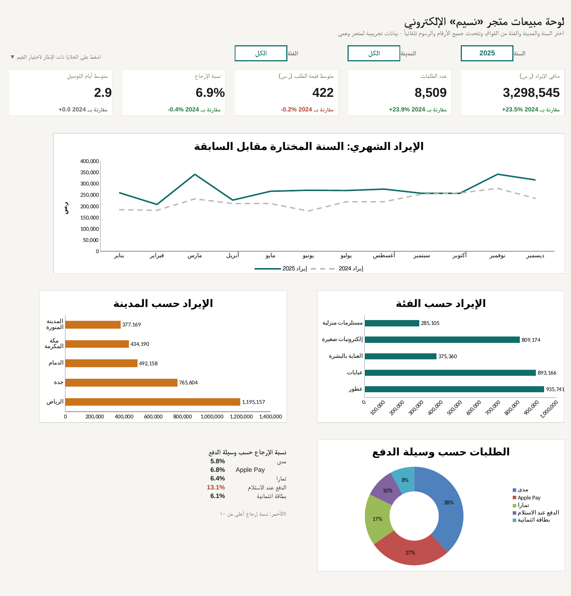

# Interactive Excel sales dashboard (Arabic, RTL)

Pick a year, city and category from dropdowns and every KPI and chart recalculates with SUMIFS/COUNTIFS, with a comparison to the previous year. No macros; works in Excel and LibreOffice.

**Demonstration project — built on public/synthetic data.** Orders come from the invented "Naseem" store in [sales-analysis-ecommerce-ksa](../sales-analysis-ecommerce-ksa/).

**[View the page →](./)** · **[Download the .xlsx](naseem-sales-dashboard.xlsx)**

- 5 KPIs with green/red change vs the previous year
- Monthly revenue vs previous year, revenue by category and city, orders by payment method
- Transparent calculation sheet; hidden list sheet feeds the dropdowns
- Built by `src/build_dashboard.py` (openpyxl); figures checked against the Python analysis

---

# لوحة مبيعات تفاعلية في إكسل (عربي)

اختر السنة والمدينة والفئة من القوائم، فتتحدث كل المؤشرات والرسوم بمعادلات SUMIFS و COUNTIFS مع مقارنة بالسنة السابقة. بدون ماكرو، ويعمل في إكسل و LibreOffice.

**مشروع توضيحي — مبني على بيانات عامة أو تجريبية** لمتجر «نسيم» الوهمي.

BahaWorks — Bahaeldin Ali
