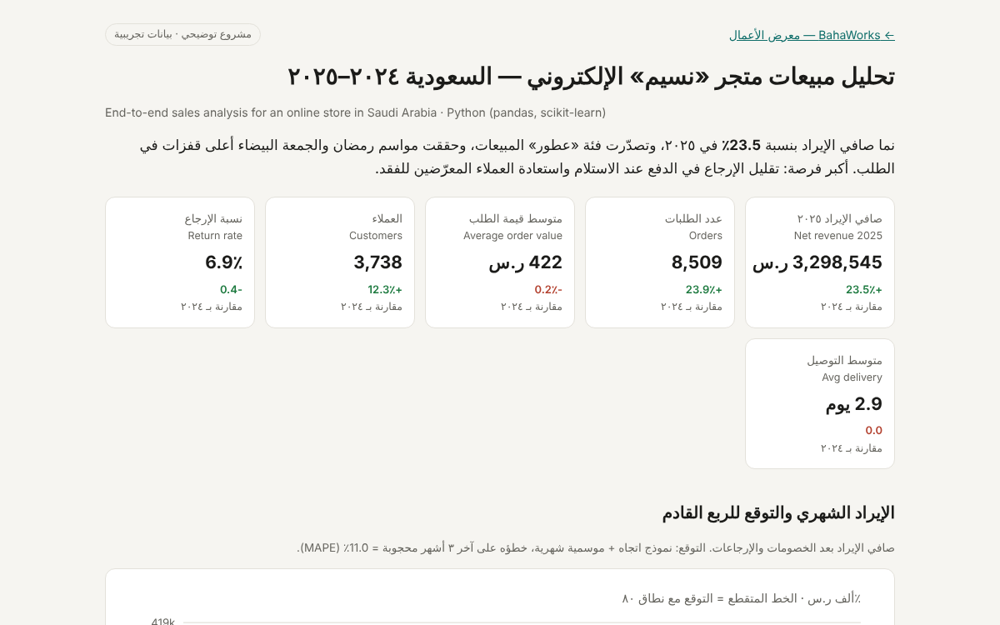

# Sales analysis — Saudi online store 2024–2025

End-to-end analysis of two years of orders for an online store in Saudi Arabia: data cleaning, KPIs, seasonality, regions, payment methods, RFM customer segments, a 3-month forecast with a holdout check, and data-driven recommendations, in a bilingual (Arabic/English) report.

**Demonstration project — built on public/synthetic data.** The store ("Naseem") and every order are invented; the data is generated by `src/generate_data.py`.

**[View the report →](./)**



## What it shows
- **Cleaning a messy export:** duplicates, test orders, refunds keyed as negative quantities, prices stored as text, cities spelled in Arabic and English several ways, missing values. Every step is logged with row counts.
- **KPIs year over year:** net revenue after discounts and returns, orders, average order value, customers, return rate, delivery time.
- **Seasonality:** uplift in Ramadan and White Friday measured against the six ordinary weeks before each season.
- **RFM segmentation:** recency, frequency and value scores, grouped into six actionable segments.
- **Forecast:** linear trend + monthly seasonality (scikit-learn), checked on a 3-month holdout (MAPE reported), with an 80% range and a stated limitation (Ramadan moves earlier each year).
- **Recommendations** generated from the numbers, not written by hand.

## Run it
```
pip install -r requirements.txt
python src/generate_data.py
python src/analysis.py
```
Outputs: `data/orders_clean.csv`, `report/metrics.json`, `index.html`.

---

# تحليل مبيعات متجر إلكتروني سعودي ٢٠٢٤–٢٠٢٥

تحليل متكامل لطلبات عامين لمتجر إلكتروني في السعودية: تنظيف البيانات، المؤشرات الرئيسية، أثر المواسم، المدن، وسائل الدفع، تقسيم العملاء (RFM)، توقع الإيراد لثلاثة أشهر مع اختبار دقته، وتوصيات مبنية على الأرقام، في تقرير ثنائي اللغة.

**مشروع توضيحي — مبني على بيانات عامة أو تجريبية.** المتجر («نسيم») وجميع الطلبات وهمية، ويولّدها الملف `src/generate_data.py`.

**[عرض التقرير ←](./)**

## ما يعرضه المشروع
- **تنظيف ملف تصدير غير مرتب:** صفوف مكررة، طلبات اختبار، استرجاعات مسجلة بكميات سالبة، أسعار مخزنة كنص، أسماء مدن مكتوبة بصيغ عربية وإنجليزية مختلفة، وقيم ناقصة، مع توثيق كل خطوة.
- **مؤشرات سنوية مقارنة:** صافي الإيراد بعد الخصومات والإرجاعات، الطلبات، متوسط قيمة الطلب، العملاء، نسبة الإرجاع، ومدة التوصيل.
- **أثر المواسم:** قفزة رمضان والجمعة البيضاء مقارنة بالأسابيع العادية التي تسبقها.
- **شرائح العملاء:** ست شرائح قابلة للتنفيذ حسب الحداثة والتكرار والقيمة.
- **التوقع:** نموذج اتجاه وموسمية، مختبر على آخر ثلاثة أشهر، مع نطاق ٨٠٪ وتوضيح حدوده.
- **توصيات** مستخرجة من الأرقام مباشرة.

BahaWorks — Bahaeldin Ali
